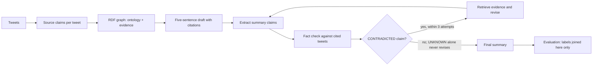

# Ontology-Driven Agent for Group-Aware Tweet Summarization

INFOIAG Group 2. A local, label-free agent that summarizes the DivSumm tweets
on three topics (Obama, McDonalds, Superbowl; 90 tweets each, written in three
dialect groups: AA, Hisp and White) in five sentences. The agent checks each
summary claim against the tweets through an RDF knowledge graph and repairs
contradicted sentences. The model is Qwen3.5-4B, run locally through Ollama.

**The dialect labels are used for evaluation only.** They never reach the
language model or the agent. `run_final_agent.py` removes every `dialectLabel`
triple from the agent's copy of the graph. It also sends every model request
through `LabelFreeClient`, which stops the run if a request contains a label.
`evaluate_label_free_run.py` is the only step that reads the labels, and it runs
after the agent has finished.

## Architecture



| Stage | Files |
|---|---|
| Data | `data/divsumm/` (the 270 input tweets), `data_loader.py` |
| Source claims (Qwen sees tweet ID and text only) | `source_claims.py`, `run_source_extraction.py` |
| Knowledge graph | `ontology/group2_Ontology.owl`, `ontology/evidence_schema.ttl`, `populate_ontology.py`, `ontology_tools.py` |
| Ontology queries | `queries/` (Q1-Q9, `source_evidence.rq`), `run_queries.py` |
| Draft summary | `summarizer.py`, `prompts.py`, `ollama_backend.py` |
| LangGraph agent | `summary_agent.py`, `summary_claims.py` |
| Fact checker | `fact_check.py`, `fact_agent.py`, `fact_tools.py` |
| Revision | `revision_retrieval.py`, `summary_revision.py` |
| Optional feedback layer | `proportion_check.py` (`--proportion-check`) |
| Logging | `live_feed.py` (event feed of each run), `model_usage.py` (model-call counts) |
| Experiment | `experiment_runner.py` (baseline and agent drafts), `rerun_agent_trials.py`, `run_pipeline.py`, `run_final_agent.py` |
| Evaluation (the only code that reads dialect labels) | `evaluate.py` (ROUGE, BARTScore, Equal Coverage, cost), `evaluate_label_free_run.py` (draft vs final), `equal_coverage.py` (MNLI Equal Coverage) |
| Tests | `tests/` (unit and integration tests with mocked model replies) |

**Fact checker.** Each atomic summary claim is judged against the tweets its
sentence cites. The verdict is SUPPORTED, CONTRADICTED or UNKNOWN; UNKNOWN is the
open-world answer when the tweets neither establish nor refute the claim. Two
rules are applied in code after the model's verdict:

- A share of the whole collection ("most") is never SUPPORTED, and "many" or
  "several" needs three quoted tweets.
- A claim about what users say is never CONTRADICTED.

The checker was revised and validated against reference labels; see
[docs/CHECKER_EVALUATION.md](docs/CHECKER_EVALUATION.md).

**Revision gate.** A rewrite is rechecked and kept only if it adds no
contradiction and raises no more issues in total; otherwise it is rolled back.

**Proportion feedback layer** (`--proportion-check`). Qwen reads all tweets of
the topic and judges whether the summary gives each main opinion its weight,
without any group label. A flagged opinion is first verified with the three
closest tweets. If a SUPPORTED claim already quotes one of them, nothing is
rewritten. A rewrite must cite one of those tweets and pass the same gate.

Earlier versions also had a group-coverage check that read the dialect labels,
and a stance-based viewpoint check. Both were removed: the first broke the
evaluation-only rule for labels, the second over-flagged (it read reported
opinions as neutral). They remain in the git history.

## Install

Use Python 3.10 or newer and [Ollama](https://ollama.com/download).

```powershell
git clone --branch checker-v2-final-results https://github.com/Lucayodad/INFOIAG-Group-2.git
cd INFOIAG-Group-2
py -3 -m venv .venv
& .\.venv\Scripts\python.exe -m pip install -r requirements.txt
ollama pull qwen3.5:4b
ollama pull all-minilm
```

On macOS/Linux use `python3 -m venv .venv` and `.venv/bin/python`. The
fresh metric evaluation downloads `roberta-large-mnli` and
`facebook/bart-large-cnn` from Hugging Face on first use.

## Reproduce the report from saved results

```powershell
& .\.venv\Scripts\python.exe .\reproduce_report.py
```

This rebuilds the numerical tables, checker comparisons, statistical tests,
annotator agreement, ontology query results and Figure 1-3 sources under
`results/report/`, using the submitted records. It does not call a model.
The citation-retrieval diagnostic uses the supplied embedding cache and its
recorded model digest. `numbers.json` retains full precision; `tables.md`
contains readable tables and `inputs.sha256.json` lists the source checksums.

For rendered SVG diagrams, install Graphviz with `dot` on PATH, then run:

```powershell
& .\.venv\Scripts\python.exe .\export_report_figures.py --render
```

The diagrams are derived from the compiled graph and the ontology; their
layout may differ from the report artwork. Figure 1 also has a Mermaid source.

## Run

One topic and prompt, end to end from the raw tweets:

```powershell
& .\.venv\Scripts\python.exe .\run_pipeline.py --topic Obama --prompt-id 1
```

This writes the source-claim checkpoint to `results/source_claims/`. The run
result and its artifacts (graph, draft, live feed) go to
`results/evidence/pipeline_runs/`. Both are gitignored.

The reported 18 trials use three topics, two prompts and seeds 101, 202 and
303. Their exact generation drafts are in `results/drafts/`; the per-trial
RDF graphs and first checks are also supplied. To rerun checking with Qwen,
use new output folders:

```powershell
# Check the saved drafts with the revised checker.
& .\.venv\Scripts\python.exe .\run_final_agent.py --out results/new_agent
& .\.venv\Scripts\python.exe .\run_final_agent.py --proportion-check --first-checks results/new_agent --out results/new_agent_proportion
# Evaluate after the agent has finished; labels are joined here only.
& .\.venv\Scripts\python.exe .\evaluate_label_free_run.py --run results/new_agent
& .\.venv\Scripts\python.exe .\evaluate_label_free_run.py --run results/new_agent_proportion
& .\.venv\Scripts\python.exe .\evaluate.py --references --out results/new_metrics.csv
& .\.venv\Scripts\python.exe .\evaluate.py --system baseline --inputs results/baseline_pc --out results/new_metrics.csv
& .\.venv\Scripts\python.exe .\evaluate.py --system agent --inputs results/new_agent --out results/new_metrics.csv
& .\.venv\Scripts\python.exe .\evaluate.py --system agent_proportion --inputs results/new_agent_proportion --out results/new_metrics.csv
& .\.venv\Scripts\python.exe .\evaluate.py --report --out results/new_metrics.csv
```

The ontology queries of the report run separately:

```powershell
# Q1-Q9 on the asserted graph and on the inferred graph (Q1, Q4, Q7 and Q8 need inference;
#   Q7 and Q8 run on a copy with the test assertions listed in run_queries.py)
& .\.venv\Scripts\python.exe .\run_queries.py
# source_evidence on one run graph: tweets and claims per group (evaluation side, reads labels)
& .\.venv\Scripts\python.exe .\run_queries.py --graph results/agent_rerun/Obama_prompt1_seed101_artifacts/Obama.ttl --topic Obama
```

`evaluate.py` writes one row per summary to `results/eval/metrics.csv` (an agent
output also yields its draft, as system `agent_draft`) and the tables to
`results/eval/report.md`. Add `--cache scores.json` to reuse MNLI and BART
scores of identical texts; on a CPU BARTScore takes about a minute per summary.

Finished trials are skipped, so rerunning a command resumes it. Qwen through
Ollama is not reproducible across sessions, even at temperature 0, so a rerun
can differ in individual verdicts.

## Tests

```powershell
& .\.venv\Scripts\python.exe -m unittest discover -s tests
```

The offline tests mock model replies (`tests/fakes.py`); every check,
tool, graph query and LangGraph transition is the real code. They cover the
claim extraction and its quotation checks, ontology population, inference and the Q1-Q9 and source_evidence queries,
`lookup_fact` retrieval, the fact checker's evidence guards, verdict validation
and counting rules, the bounded revise-recheck-rollback loop, the proportion
layer, the label-free guarantees (no request carries a label, the agent's graph
has none), the pipeline end to end from raw tweets to saved results, the metrics
and cost accounting, and replays of the recorded runs. One test calls the live
models and runs only with `INFOIAG_LIVE=1`; one documents a known limitation as
an expected failure.

## Results

| Folder | Contents |
|---|---|
| `results/agent_checker_v2/` | **Final run**: 18 trials, revised checker, with `evaluation.json` and `summary.json` |
| `results/agent_checker_v2_proportion/` | Final run with the proportion feedback layer |
| `results/eval/` | Summary quality (ROUGE, BARTScore), fairness (Equal Coverage per dialect group) and cost of every system: `metrics.csv` and `report.md` |
| `results/baseline_pc/` | The 18 baseline summaries (one Qwen call, no agent) |
| `results/checker_evaluation/` | Checker validation: reference labels, labeling guideline, scored runs, scripts, 60-claim validation sheet with the labels of two LLM annotators (`scripts/kappa.py` computes Cohen's kappa) |
| `results/agent_compliant_v2/` | Original-checker comparison reported in Tables 13-14 |
| `results/agent_final/` | Recorded first checks; `run_final_agent.py` reuses their claim extraction |
| `results/agent_rerun/`, `results/evidence/` | Recorded drafts and per-trial RDF graphs used by `run_final_agent.py` |
| `results/drafts/` | The 18 exact generation drafts used in the reported trials |

Main findings, detailed in [docs/CHECKER_EVALUATION.md](docs/CHECKER_EVALUATION.md):

- On the held-out topics the revised checker's accuracy is 0.80; the original
  checker's was 0.69.
- With the revised checker the 18 drafts contain 0 contradicted claims, so
  the agent changes 0 of 18 summaries.
- With the proportion layer one summary changes.
- Mean dialect Equal Coverage is 0.0024 in both runs.
- Summary quality is unchanged by the agent (ROUGE-1 0.224, BARTScore
  faithfulness -3.60, as for its drafts). The agent's checking costs about 24
  model calls, 53k tokens and 700 s per trial, against one call and 21 s for
  the draft. See `results/eval/report.md`.

## Limitations

- The checker's reference labels were made by an LLM and validated by two
  further LLM annotators on a 60-claim sample (Cohen's kappa 0.90 against the
  reference, 0.93 between them). Validation by people is still open.
- The checker confirms about 6 in 10 supported claims. A claim with wrong
  citations stays UNKNOWN.
- Every result comes from a single run of a 4B model.

Dataset provenance: [data/divsumm/README.md](data/divsumm/README.md). Ontology:
[ontology/README.md](ontology/README.md).
