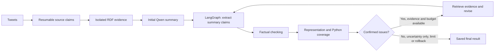

# INFOIAG: ontology-assisted summarization

A local research prototype that summarizes tweets, checks factual support and
group representation using RDF evidence, and revises/rechecks a five-sentence
summary when confirmed issues justify it. Supports **Obama, McDonalds and
Superbowl**, two prompts, and 90 tweets per topic (30 each labelled AA, Hisp and
White). Luca's original OWL ontology and datasets are preserved. Working software
does not establish experimentally validated model accuracy or fairness.



## Install from a fresh clone

Use Python **3.10 or newer**. Install and start [Ollama](https://ollama.com/download).
Windows PowerShell:

```powershell
git clone --branch feature/saif-agent-implementation https://github.com/Lucayodad/INFOIAG-Group-2.git
cd INFOIAG-Group-2
py -3 -m venv .venv
& .\.venv\Scripts\python.exe -m pip install -r requirements.txt
ollama pull qwen3.5:4b
ollama pull all-minilm
```

For an existing clone, switch to the feature branch, pull, and reinstall
requirements. No API key, personal directory, external dependency folder,
VS Code configuration or pre-generated results are required. If needed, start
`ollama serve` in another terminal. The runner checks both models before starting
and prints model installation commands if they are missing.

On macOS/Linux, create the environment with `python3 -m venv .venv` and use
`.venv/bin/python` instead of `.venv\Scripts\python.exe` in the commands below.
Install requirements with `.venv/bin/python -m pip install -r requirements.txt`.
The same two `ollama pull` commands apply.

## Run the complete agent

From the repository directory:

```powershell
& .\.venv\Scripts\python.exe .\run_pipeline.py --topic Obama --prompt-id 1 --disparity-threshold 0.25 --max-revisions 3
& .\.venv\Scripts\python.exe .\run_pipeline.py --topic McDonalds --prompt-id 1 --disparity-threshold 0.25 --max-revisions 3
& .\.venv\Scripts\python.exe .\run_pipeline.py --topic Superbowl --prompt-id 1 --disparity-threshold 0.25 --max-revisions 3
```

Use `--prompt-id 2` for the other prompt. **0.25 is exploratory, not a
paper-established disparity threshold.** Each command runs one topic/prompt,
not all 36 research experiments. Local runs can take substantial time depending
on hardware. Stage/call progress and completed-call timings are printed without
large JSON dumps. Each model request has a 300-second timeout.

Options (`python run_pipeline.py --help` lists all arguments):

- `--output results/evidence/my_run.json`: choose a new final JSON path; existing
  outputs are rejected. Omit it for a unique filename every time.
- `--source-claims path/to/checkpoint.json`: select a source checkpoint.
- `--reuse-draft path/to/draft.json`: explicitly reuse a compatible saved draft. Its topic and prompt
  provenance must match the requested run; conflicting or missing prompt metadata
  is rejected. Otherwise a new initial summary is generated.
- `--max-revisions 0`: check-only mode; allowed values are 0 through 3.
- `--max-model-calls 64`: representation chat budget per pass; half is reserved
  for coverage. `--max-tool-calls 3`: factual retrieval budget per summary claim.

## Live agent feed

Every complete run prints timestamped `actor -> recipient` events and writes a
flushed `live_feed.jsonl` inside its artifacts directory. The result manifest
records that path. It shows actual stage handoffs, model requests and replies,
validated tool choices, returned evidence, equivalence/coverage validation,
routing, revision acceptance/rejection/rollback, errors and saved results.
Model replies are labelled **validation pending** until a checker accepts them.
Long model calls emit a waiting heartbeat every 30 seconds. These are observable
structured actions and shared-state transitions; previews are bounded and full
evidence remains in the normal result. Monitoring does not make additional model
calls or change judgments.

The feed can be read while the run is active, including by an assistant monitoring
and relaying entries in chat. To follow the printed feed path in PowerShell:

```powershell
Get-Content -LiteralPath "path/to/run_artifacts/live_feed.jsonl" -Tail 10 -Wait
```

## Outputs and resuming

The runner creates all directories automatically. Generated artifacts are
gitignored and are not downloaded by pulling the code:

- `results/source_claims/<topic>.json`: source checkpoint, reused across prompts.
  Saved successful tweets are skipped. Failed tweets receive at most three
  attempts and are logged in `<topic>.failures.json`; failures are never saved
  as fabricated claims or `no_claim`.
- `results/evidence/pipeline_runs/<topic>_prompt<id>_<unique-id>.json`: default
  complete agent state, evidence, summaries, issues, calls and stop reason.
- `<final-file-stem>_artifacts/` beside the final JSON: topic RDF `.ttl`, initial
  summary `.json`/`.txt`, and a manifest with paths, counts and model digests.
  A failed stage creates `error.json` there.

Rerun the topic command to resume missing source extractions. When `--output`
is explicit, select a new filename after a completed run. LangGraph restarts its
checking/revision pass; it has no mid-call resume checkpoint. Review UNKNOWN and
failed results before using them in the report/poster.

## Tests and controlled demonstration

```powershell
& .\.venv\Scripts\python.exe -m unittest discover -s tests -q
& .\.venv\Scripts\python.exe .\demo_revision_loop.py
```

Tests/default demos use complete synthetic evidence with mocked Qwen responses
and embeddings. They verify fresh-input execution, checkpoint recovery,
revision/rechecking/rollback, provenance, group weights, conservative uncertainty
and 166-viewpoint budget behavior. They do not establish real-model accuracy.
Real-model release verification is recorded in [docs/RELEASE.md](docs/RELEASE.md).

## Representation and known limitations

Exact duplicates are grouped deterministically. Larger inputs use local
`all-minilm` embeddings and in-memory cosine similarity to shortlist at most two
earlier same-stance candidates (similarity >= 0.8). Small Qwen requests verify
equivalence; embeddings never authorize a merge. These retrieval parameters are
engineering choices, not validated research metrics. Every merge requires valid
source IDs, exact quotations and consistent stance.

Equivalence uses at most half the chat budget; independent coverage tasks follow.
Invalid tasks get one retry within their budget. Unknown or failed assessments
remain UNKNOWN. Python preserves distinct-tweet weights and the existing
coverage/disparity formulas. Unresolved equivalence keeps conservative bounds;
UNKNOWN is never converted into an omission or measured improvement.

The shortlist is approximate and can miss paraphrases. Numeric coverage is
conditional on an **unreviewed, retrieval-scoped partition**, not proof of global
equivalence. Sarcasm, extraction errors, attribution, quantifiers, coverage
granularity, model-sensitive judgments and local timeouts remain limitations.
Revision requires validated citations and both checks repeated; unsupported
changes are rejected/rolled back. Scientific evaluation and human assessment
remain separate work.

## Existing interfaces

Earlier commands remain available:

```powershell
& .\.venv\Scripts\python.exe .\run_source_extraction.py --topic Obama --limit 90
& .\.venv\Scripts\python.exe .\populate_ontology.py --topic Obama
& .\.venv\Scripts\python.exe .\main.py --section draft --topic Obama --prompt-id 1
& .\.venv\Scripts\python.exe .\summary_agent.py path/to/draft.json --graph path/to/Obama.ttl --topic Obama --disparity-threshold 0.25 --max-revisions 3
```

`summary_agent.py` consumes saved inputs; `run_pipeline.py` creates them. For
inspection use `python main.py --section data` or `--section ontology`.
Optional OpenAI initial generation remains explicitly selectable; the full
pipeline uses local Ollama.

Details: [ontology/query scope](docs/SECTION_2.md), [generation](docs/SECTION_3.md),
[checkers](docs/CHECK_COMPONENTS.md), [LangGraph/revision](docs/SUMMARY_AGENT.md),
[dataset provenance](data/divsumm/README.md), [ontology](ontology/README.md).
