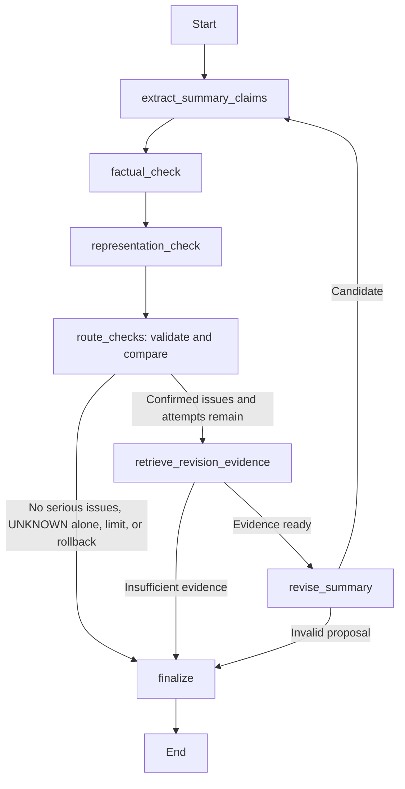

# LangGraph revision and rechecking

Current default: MNLI coverage over original summary sentence entries, shared
with offline evaluation. The internal claim metric described below remains
available explicitly. See [report validation](REPORT_VALIDATION.md) for the
metric version, usage accounting, safeguards and evaluation commands.

The controller consumes an existing five-sentence draft and a populated,
asserted RDF graph. Source extraction, population and initial generation still
happen before this graph. Experimental metrics and the 36-run evaluation are
outside this implementation.

For a fresh-clone complete run, use `python run_pipeline.py --topic Obama --prompt-id 1`.
It resumes source claims, populates RDF, generates a draft and invokes this
existing graph. See the README and [release notes](RELEASE.md).

The checker interfaces and graph nodes are unchanged by the pilot reliability
fixes. Factual calls now use compact evidence with validated short-ID mappings
and one format repair. Representation performs equivalence and coverage in
separate bounded tasks, continuing independent batches after a rejected task.
Retries count toward the existing controller call totals. See
[checker mechanics and limits](CHECK_COMPONENTS.md) for the updated protocols.



The graph follows the documented [LangGraph StateGraph API](https://docs.langchain.com/oss/python/langgraph/graph-api).

## Connections to existing code

| Node/function | Implementation |
| --- | --- |
| `extract_summary_claims` | Calls `extract_sentence` five times and validates with `flatten_summary_claims`. Failed extraction remains `unclear`, with an explicit error. |
| `factual_check` | Reuses `fact_check_summary` and its bounded `run_fact_agent`, original retrieval tools, evidence guards and traces. |
| `representation_check` | Reuses the existing RDF retrieval, aggregation/matching, weighted coverage, disparity and uncertainty bounds. |
| `retrieve_revision_evidence` | New function in `revision_retrieval.py`, reusing `lookup_fact` and `get_group_claims`. |
| `revise_summary` | New function in `summary_revision.py`, using `OllamaClient.chat` and `summarizer.validate_output`. |
| `route_checks` | Records checked iterations, compares measured progress, accepts or rolls back, then selects an edge. |
| `finalize` | Returns `completed`, `completed_with_uncertainty`, or `stopped_with_issues`, retaining the chosen summary and stop reason. |

`validate_output` additionally accepts `allowed_source_ids`. Its original
tweet-list interface and validation rules remain. This avoids constructing
fabricated Tweet objects merely to validate a citation whitelist.

## Bounded embedding retrieval

The default model is local `all-minilm`, separate from Qwen, through Ollama's
[`POST /api/embed`](https://docs.ollama.com/api/embed). Truncation is disabled;
finite, nonzero vectors with matching dimensions are required. No vector
database, NumPy or new Python embedding framework is introduced.

For fixed embeddings and source data, retrieval is deterministic:

1. Only serious factual issues or conclusive representation FAIL are actionable.
2. Factual tasks prioritize original cited tweets retrieved by `lookup_fact`, then
   rank relevant topic tweets by cosine similarity.
3. Representation tasks consider confirmed NOT_MATCHED viewpoints supported by
   the affected group. Selection prioritizes the greatest normalized coverage
   gain relative to other groups, then supporter counts and canonical IDs. An
   equally shared omission that leaves disparity unchanged has lower priority.
4. Cosine ranking is restricted to that group's original supporters for the
   chosen omission. Score ties use original tweet IDs.
5. A factual sentence needing repair is reused where possible. Otherwise the
   last no-claim sentence, then the last sentence, is targeted. Rechecking must
   reject any resulting loss of measured fairness or factual support.

Full tweet quotations, original IDs, literal dialect labels, source file/line,
task evidence IDs and cosine scores are retained. Default limits: three tweets
per task, nine unique tweets, 7,000 evidence bytes, and 14,000 bytes for the full
Qwen request including its schema/instructions. Whole tweets are kept or omitted;
none are silently truncated. Missing evidence, ambiguous fields/IDs, invalid or
unavailable embeddings, or inability to cover tasks within limits stop revision.
No lexical fallback substitutes for embedding retrieval.

Embeddings are cached by model/text in memory for the run, outside typed state.
Selected evidence and the model name are recorded. Reproducible experiments
should pin the embedding model digest/runtime as well as the Python versions.

## Targeted revision and validation

Qwen returns only `{replacements: [...]}` with targeted sentence IDs, text,
source IDs and exact supporting quotations. It cannot change other slots;
unaffected text and citations remain identical. Existing validation preserves
five entries and rejects empty citations, unknown IDs, duplicate text, line
breaks and malformed entries. Additional guards reject duplicate/unaffected
targets, unassigned citations, fabricated quotes and missing group support.
The prompt requires one complete sentence per slot; grammatical segmentation
is not independently proven by the structural validator.

A refuted assertion may be removed and replaced with a grounded viewpoint.
New text cites evidence supporting its new content, not necessarily the source
that refuted the old claim. Representation edits must still cite an assigned
original tweet from the required group.

Passing these checks creates an **unaccepted candidate**. The controller then
re-extracts claims and reruns both complete checkers. Every changed sentence must
contain extracted claims that are all SUPPORTED with complete cited evidence.
UNKNOWN/no_claim cannot erase a known error and count as a repair. Provenance
validation alone is not entailment, and the subsequent semantic support remains
an unreviewed model judgment rather than a formal proof.

## Progress, rollback and stopping

At most three Qwen revisions are attempted (`max_revisions=0..3`). A malformed
model reply counts as an attempt. Retrieval failure or an input-budget rejection
before calling Qwen does not. Every formed candidate is fully rechecked.

Acceptance requires fewer serious factual issues or strictly smaller measured
internal disparity, with no regression:

- Serious factual issues and unresolved factual issues cannot increase. Changed
  sentences must all be supported.
- Measured disparity requires complete source evidence, known group coverages,
  no UNKNOWN matches and a conclusive PASS/FAIL. UNKNOWN cannot be a numeric
  improvement, even if a conditional point estimate exists.
- Source-claim partitions and supporter sets are hashed and compared. A changed
  partition cannot establish disparity progress; a previously measured disparity
  becoming unknown or incomparable causes rollback.
- Measurable disparity cannot worsen (`1e-12` tolerance), and a new representation
  FAIL cannot be traded for fewer factual issues.

This conservative Pareto rule retains the best checked version without inventing
a combined score. No improvement, unsupported changes, increased uncertainty or
regression cause rollback and termination. UNKNOWN alone never starts revision.

Stop reasons: `no_confirmed_serious_issues`, `uncertainty_only`, `revision_limit`,
`insufficient_revision_evidence`, `invalid_revision`, `revision_input_budget`,
`unsupported_revision`, `factual_regression`,
`representation_regression_or_incomparable`, or `no_improvement`.

## State, evidence and counts

State preserves `initial_summary`, retained `current_summary`, `summary_versions`
(including valid candidates later rolled back), and all `revisions` including
raw rejected replies. Every complete check cycle is in `iterations`, with the
summary, extracted claims, factual issues/results, coverage, disparity, partition
signature and cumulative counts. `best_iteration` identifies the retained check
snapshot; returned checking results describe that summary after rollback.

`retrieval_history`, `routing_decisions` and `execution_history` preserve evidence
attempts, routes, stop reasons and before/after snapshots. Existing checker
traces retain individual model/tool observations. `call_counts` separately totals
Qwen chat calls, retrieval tool invocations and embedding requests, including
failed attempts. Extraction, both checkers and revision are included in chat
counts; embedding requests are separate.

The graph/client remain outside state. An RDFLib `ReadOnlyGraphAggregate`
rejects writes. No source, ontology assertion or input draft is rewritten.
Caller-supplied clients stay open; an internally created client closes on return
or exception. Returned state is JSON-serializable.

## Usage

```bash
python -m pip install -r requirements.txt
ollama pull all-minilm
```

Qwen remains `qwen3.5:4b`; revision needs no additional Python dependency.

```python
result = run_summary_agent(
    graph, draft, topic="Obama", prompt=draft["summary_prompt"],
    disparity_threshold=chosen_research_threshold, max_revisions=3,
)
```

Use the saved draft dictionary from `generate_summary`, with five `{text,
source_ids}` entries. Definitive full-topic coverage requires complete extracted
source evidence: 30 tweets per group by default. Small synthetic fixtures must
explicitly supply `expected_group_counts`. The threshold is a caller setting;
omitting it in the Python interface preserves uncertainty. The CLI separately
defaults to 0.25 for an exploratory pilot; this is not a paper-established value.

Existing checker options remain. Revision options: injectable `embedder` callable
(`texts -> vectors`), `embedding_model="all-minilm"`, `revision_top_k=3`,
`max_revision_tweets=9`, `revision_evidence_bytes=7000`,
`revision_max_input_bytes=14000`, and `max_revisions=3`.

```bash
python summary_agent.py path/to/draft.json --graph path/to/Obama.ttl --topic Obama --disparity-threshold 0.25 --max-revisions 3 --output results/evidence/agent_run.json
python demo_revision_loop.py
python demo_revision_loop.py --live
python -m unittest discover -s tests -v
```

The example threshold 0.25 is illustrative, not paper-established.
`demo_summary_agent.py` remains a check-only demo (`max_revisions=0`).

The real-data entry point is `summary_agent.py`, not either demo. It loads the
saved graph/draft, calls `run_summary_agent` with its real local Ollama client,
and reads prompt text from the draft's `summary_prompt` unless `--prompt` is
supplied. It does not repeat initial generation or source extraction.

`--output` saves the complete state. Without it, a unique JSON file is always
saved under `results/evidence/agent_runs/`, relative to the repository directory.
The terminal prints factual counts, group coverage/bounds and source counts,
representation status/disparity/threshold, revisions, final status and stop
reason. Incomplete source evidence is explicitly identified. Existing five-tweet
samples must not be presented as complete 90-tweet evidence.

For PowerShell, use the project interpreter directly to avoid activation-policy
issues: `& .\.venv\Scripts\python.exe .\summary_agent.py ...`. Install
`requirements.txt` in that environment first; it includes LangGraph. A fresh
checkout needs no developer-specific paths or additional `PYTHONPATH` setting.

## Demonstration and readiness

The controlled demo uses nine synthetic tweets, gold-topic mock vectors and
mocked Qwen replies; all retrieval, checkers and graph logic execute normally.
One revision replaces the contradicted second sentence with a group-supported
omitted viewpoint. Serious factual issues fall 1 → 0. Coverage changes from
AA 2/3, Hisp 2/3, White 1/3 to 2/3 for every group; disparity falls 1/3 → 0.
Unaffected sentences remain exact. Full state: `results/evidence/revision_demo.json`.

`--live` separately uses real local embeddings and one Qwen proposal on controlled
evidence, saving `revision_live_probe.json`. It is a development probe with
controlled issue inputs, not a real-topic accuracy evaluation or a fully accepted
live revised summary. Valid output is only a candidate until full rechecking;
invalid output is saved and rejected without replacing the summary.

Tests cover factual and representation repair separately/together, UNKNOWN alone,
invalid revisions, missing evidence, unsupported additions, no improvement,
three attempts, prior-best retention, unchanged sentences, both rechecks,
UNKNOWN/changed-partition metrics, and a complete controlled 90-tweet loop.

The agent is mechanically ready for a real 90-tweet topic given complete source
extractions, a populated graph, valid draft, configured threshold and local
models. This is not established semantic accuracy. Sarcasm, attribution,
embedding relevance, greedy sentence/viewpoint choice and model partitions still
need manual validation. Strict guards may stop useful candidates. No final
experimental metrics or full 36-run batch is implemented here.
